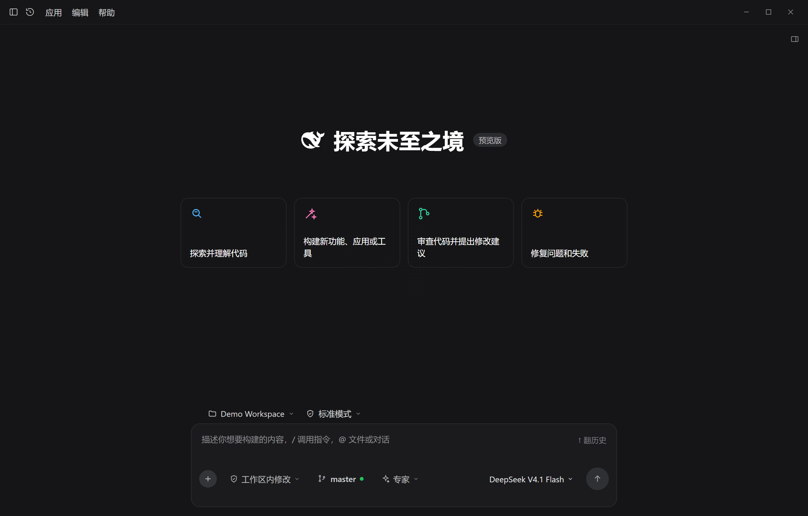
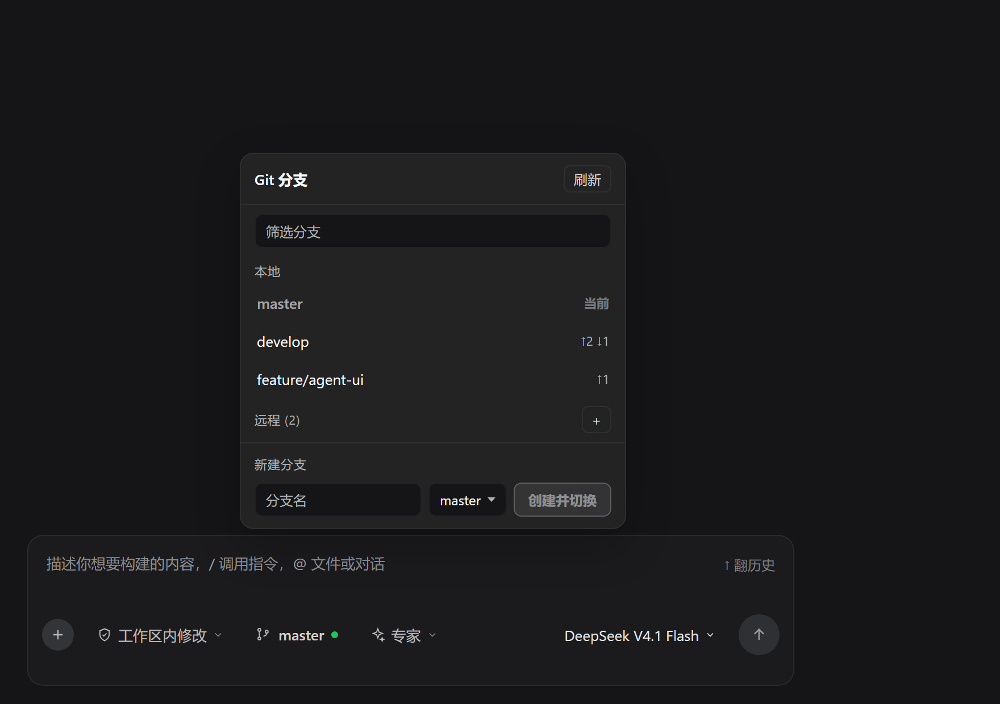
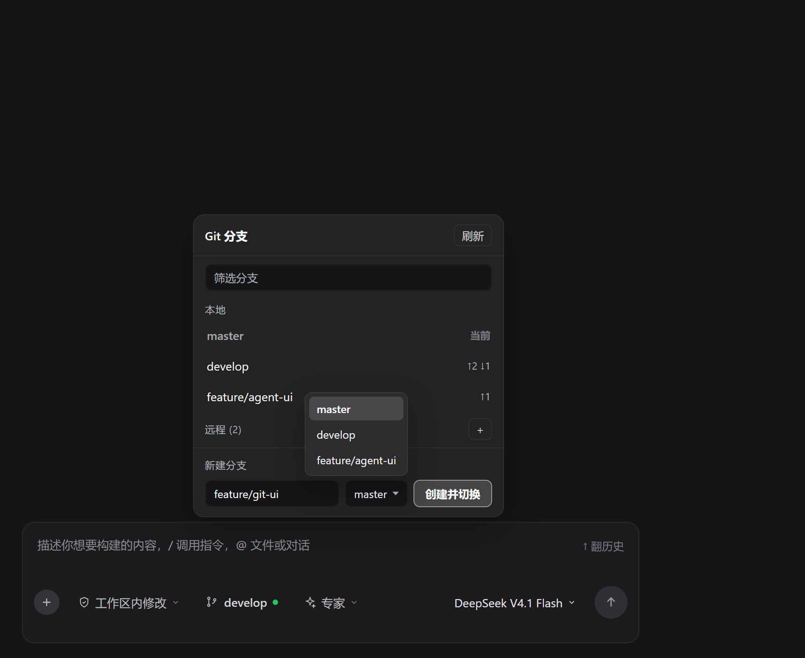
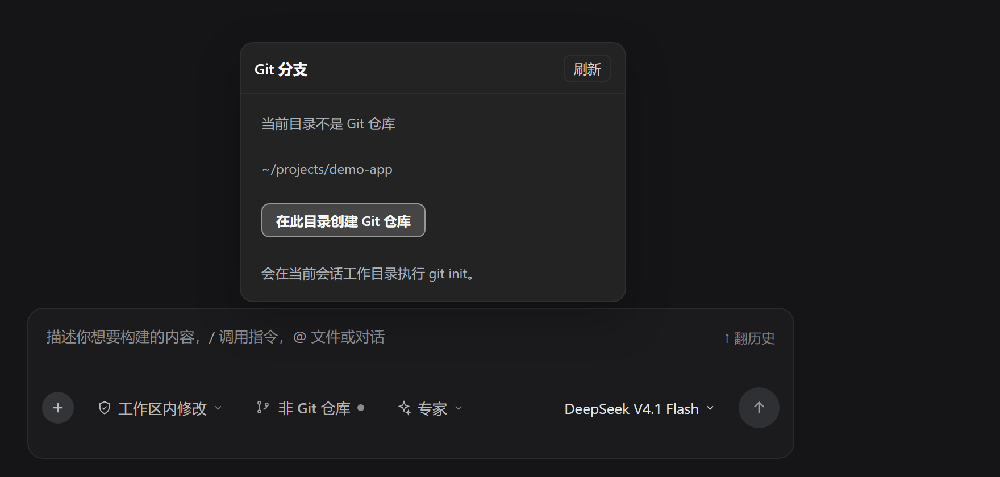

# dsh-git-branch

DSH bundle：在对话里切换 / 新建 Git 分支，支持为非 Git 目录初始化仓库，控件位置可在设置里改。

- 控件：composer / 会话标题右侧等 5 个位置之一（设置 → Git 分支）
- 工具：`git_branch`（list / switch / create / init / delete）
- 命令：`/branch [list | switch <名> | create <名> [起点] | init]`

## 界面

分支控件挂在输入框工具栏里：分支图标 + 当前分支名 + 状态点，点开是一个分支面板。



### 分支面板

本地分支排在前面，远程分支收在后面（带数量，可展开）；顶部是筛选框，当前分支标「当前」且不可点；行尾的 `↑N` `↓N` 是与上游的 ahead / behind 差距。点任意分支直接切换，切换后控件标签和状态点立即刷新。



### 新建分支

面板底部是新建区：「分支名」+「起点」+「创建并切换」。起点下拉列出本地分支，默认是当前分支；填好名字回车即创建并切换过去，不必再敲命令。



### 非 Git 目录

工作目录还不是仓库时，控件显示「非 Git 仓库」（灰点），面板里给一个「在此目录创建 Git 仓库」按钮，就地执行 `git init`。



状态点：绿点 = 工作区干净，黄点 = 有未提交改动，灰点 = 正在读取或不是仓库。

*图为深色主题下的界面示意，工作区与分支名为示例数据。*

## 安装

用 `plugin_manager` 的 `install_bundle` 指向这个目录（本地目录会被链接安装，不需要打包）：

```
plugin_manager action=install_bundle target=<此目录绝对路径>
```

## 结构

| 文件 | 作用 |
| --- | --- |
| `lib/git.js` | 纯 git 核心：探测仓库、读状态、切换、新建、初始化、删除；只依赖注入的 `run(args)` |
| `lib/index.js` | Host 半侧：4 个 loopback HTTP 路由 + `git_branch` 工具 + `/branch` 命令 |
| `lib/client.js` | Client 半侧：分支控件、面板、设置页；只 require `react` 与 `react-dom` |
| `cordis.patch.yml` | bundle 插入行 |
| `locale/*.json` | Plugin Manager 的标题 / 描述 / 详情路径 |
| `docs/DETAIL.md` | 详情页文档 |
| `docs/images/*.png` | 上面四张界面图（2× 截图，深色主题） |
| `test/git.test.mjs` | 假 runner 的核心逻辑测试（不需要真仓库） |

## 开发

```bash
node --test test/
```

只测 `lib/git.js`（纯函数 + 注入 runner），Host 路由与 UI 通过安装后的实际界面验证。

## 投稿到插件市场

用独立的公共工具 `dsh-market-publish`（同级目录 `../dsh-market-publish`）：

```bash
npx dsh-market-publish                  # 自检 + 生成条目
GITHUB_TOKEN=xxx npx dsh-market-publish --apply
```

## 显示位置

见 `docs/DETAIL.md`。偏好存 `localStorage`，不写 profile 配置。
